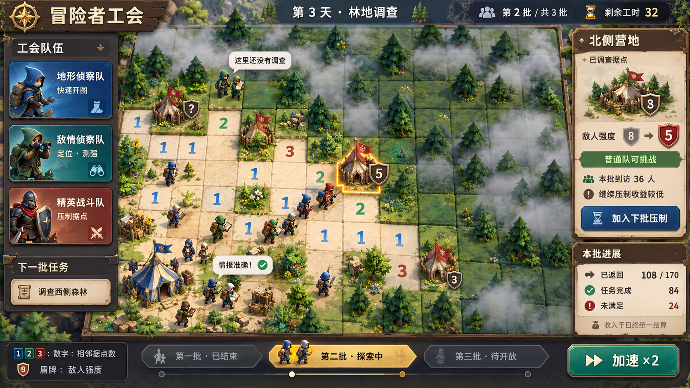

# 冒险者工会 · 玩法设计文档 v0.1

> 日期：2026-10-19
>
> 状态：讨论方案，供玩法原型验证；尚未实现，也不替换现有版本规则。
>
> 本版基线：每天新地图、扫雷推理、三类工作队、分批冒险、当天结束统一结算。
>
> 文中的批次数、人数分配、工时与强度门槛均为原型建议，不是已验证数值。



> 界面概念预览：森林扫雷棋盘、三类工作队、分批探索与据点经营反馈。此图用于讨论视觉与信息层级，非游戏实机截图；图中数字不作为可解棋盘或最终平衡依据。由内置 image_gen 生成，[生成提示词](冒险者工会-预览图-v0.1.prompt.txt)。

## 1. 游戏定位与设计边界

玩家扮演冒险者工会主席，组织队伍调查森林，根据扫雷数字整理安全区域和敌人据点情报，再投入精英战斗队压制危险地点。普通冒险者依据工会发布的信息进入森林，完成探索、采集和讨伐；他们的经历决定当天收入与评价。

核心体验是：**我调查和治理过的地方，正在被冒险者使用；他们能不能顺利回来，取决于我的判断与安排。**

### 1.1 已明确的方向

- 扫雷仍是基础玩法：通过相邻数字判断安全格与敌人据点。
- 玩家既可以亲自操作，也可以指挥自动工作队。
- 地形侦察队负责快速打开可推理的安全地格。
- 敌情侦察队负责定位据点、调查强度，也能较慢地开图。
- 精英战斗队成本高，负责削弱敌人强度。
- 敌人强度是独立于扫雷数字的经营数值。
- 每天是一关；下一关使用全新地图，地图经营状态从零开始。
- 当天没有经营收入回流；地图上的冒险结果记账，当天结束才统一发放收入。
- 未调查区域主要造成需求未满足；错误安全情报造成更严重的后果。

### 1.2 本版采用的推荐结构

采用“分批探索的营业日”：玩家准备一版地图，放行一批冒险者，观看他们使用地图，再根据反馈继续调查和压制，为下一批改善条件。当天所有批次结束后统一评分。

这保留了关卡的开始与结束，也让经营反馈发生在局内。它与“所有人只在最后出发”的方案相比，多了一层工作顺序的决策。

### 1.3 暂不引入

- 同一地图跨天经营、据点跨天保留、旧地区持续收租。
- 当天靠冒险收益购买更多工作队的滚雪球经济。
- 建筑链、道路铺设、商店补货、逐个冒险者装备管理。
- 必须不停点击救人、收钱的实时干扰。
- 战斗后修改雷位或重算扫雷数字。

工会资金、队伍升级等是否跨天保留，尚未决定。本版基础循环必须在固定开局配置下也能成立。

## 2. 核心循环与玩家决策

### 2.1 一天的循环

```text
进入全新地图，查看当天需求与可用资源
    ↓
开图获得线索，发现安全地点与敌人据点
    ↓
在扩张、查明敌情、压制据点之间分配工作量
    ↓
发布本批地图，冒险者出发
    ↓
完成任务 / 无法前往 / 撤退受伤 / 遭遇伏击
    ↓
看见本批瓶颈，改善下一批使用的地图
    ↓
最后一批返回，统一结算收入与评价
    ↓
进入下一关，全新地图重新判断
```

### 2.2 三种主要投入

| 投入方向 | 主要收益 | 放弃的机会 |
|---|---|---|
| 扩大调查范围 | 增加可探索区域，发现更多潜在目的地 | 已发现地点可能仍有情报缺口或危险 |
| 深入调查敌情 | 知道据点在哪里、有多强，减少错误与未知 | 地点数量可能不足 |
| 集中压制据点 | 扩大能挑战据点的人群，提高完成率 | 资源集中于少数地点，远处需求可能落空 |

三种投入都应有价值，地图与当天需求决定比例。设计目标是让玩家根据新局面调整，而不是每关机械执行同一个购买顺序。

### 2.3 玩家持续负责的工作

- 读数字，解决自动队伍无法处理的推理。
- 选择工作区域和任务优先级。
- 判断哪个地点值得进一步投入。
- 决定本批发布哪些情报，哪些区域继续保持未知。
- 在有限投入下，为下一批完成收尾。

自动队伍承担确定性推理和重复执行，不自动替玩家选定全图最优经营方案。

## 3. 地图、情报与敌人强度

### 3.1 两套数字严格分开

| 数字 | 含义 | 获得方式 | 当天是否变化 |
|---|---|---|---|
| 扫雷数字 | 周围八格的原始敌人据点数量 | 打开安全地格 | 不变化 |
| 敌人强度 | 据点当前的挑战难度 | 敌情调查 | 可以被精英队降低 |

数字推理只能定位据点，不能推出敌人强度。定位与测强是两份不同的成果。

精英队压制成功后，据点继续计入扫雷数字。即使强度降到零，地格也保留“已肃清据点”身份，不变成会让周围数字失真的普通安全格。数字的界面解释应使用“相邻据点数”，避免被理解成“相邻尚存敌人数量”。

### 3.2 地图信息状态

地图需要区分真实情况、玩家掌握的信息和已发布信息。玩家与自动队伍只能依据可见情报作决策，系统结算才能读取真实情况。

| 信息状态 | 含义 | 冒险者如何使用 |
|---|---|---|
| 未调查 | 没有安全承诺，也没有据点详情 | 不深入，相关需求可能无法完成 |
| 已调查安全 | 已开出的安全地格 | 可用于普通探索和采集 |
| 玩家声明安全 | 玩家对尚未实地调查地格作出的安全判断 | 发布后作为安全情报使用，错误时可能伏击 |
| 标记为据点，强度未知 | 判断存在敌人，尚未测强 | 显示危险，普通人不盲目挑战 |
| 据点位置与强度已调查 | 具备可用于选择队伍的完整情报 | 按能力决定是否接取任务 |
| 已压制据点 | 调查完整，当前强度已降低 | 更多能力档的冒险者可以前往 |

“玩家声明安全”是实现错误安全情报后果所需的推荐入口，具体操作方式待交互原型确认。它应与“已实地调查安全”有不同标识，不能让玩家误以为两者可靠程度相同。

**错误类型要分别处理：**

- 把真实敌人据点声明为安全：错误安全承诺，可能导致伏击与死亡。
- 把安全格标成敌人据点：错误危险情报，主要导致绕行、浪费调查或遗漏收益，不应凭空生成敌人杀人。
- 保持未知：未承诺安全，主要损失机会。

未发布前可以修改判断；已经发生的冒险结果不会因后来修正标记而撤销。

### 3.3 发现地点不等于充分利用地点

经营一个地点主要经历：发现位置 → 查明条件 → 压低危险 → 满足更多需求。

第一版只需安全探索地点和敌人据点两类。药草地、旧矿场、遗迹等可以作为表现和需求标签，不必立即做成多套独立产业系统。

## 4. 三类工作队

| 队伍 | 定位 | 工作方式 | 主要限制 |
|---|---|---|---|
| 地形侦察队 | 快速扩大安全信息 | 在指定区域内根据数字执行确定性开图 | 不负责测强，不靠真实雷位作弊开图 |
| 敌情侦察队 | 形成可使用的敌情报告 | 推理标记敌人，定位后花工作量调查强度；可慢速开图 | 综合能力较强，但开图效率低于地形队 |
| 精英战斗队 | 提高危险地点的利用价值 | 对已定位、已调查的据点投入压制 | 单次成本高，不承担大范围侦察 |

队伍名称描述职责，不表示万能的上下位替代。仅购买敌情队不应同时获得最优开图效率；只买战斗队也不能绕开定位与调查。

### 4.1 自动化与资源消耗

原型建议：当天采用有限工时，手动有效调查与队伍实际工作都消耗工时。布置任务和观察可以从容进行；空操作、查看信息与纯等待不应扣工时。

自动化的价值是减少重复操作并提高单位工时效率。实际动作仍有成本，不能靠挂机无限打开地图。

具体成本表待验证，但必须满足：

- 地形队打开确定安全格最划算。
- 敌情调查的价值来自减少信息缺口和支持后续压制。
- 精英压制有明显机会成本，不能全图无差别压到最低。
- 手动操作不能免费完成所有队伍工作，绕过整套资源约束。
- 开格直接遭遇敌人的规则必须另行确定；若允许暴力试探，其代价不能低到替代数字推理。

队伍雇佣成本可以在开局配置时体现；不要求当天中途购买或升级。原型阶段先验证任务分配，避免同时叠加工时、体力、补给等多套限制。

## 5. 营业日与分批探索规则

### 5.1 推荐原型：三批冒险者

以一天 500 名冒险者为表现目标，初始可拆为 160 / 170 / 170 人，人数与批次数可调整。

每批采用“准备 → 发布 → 探索 → 反馈”的顺序。准备阶段不以现实时间催促玩家；玩家主动发布后，冒险动画播放，可加速。

为避免玩家在第一批之前做完全天工作，每批开放一部分工时，不能预支后续批次。未使用工时可结转下一批，允许节省资源集中压制，但会失去早期服务机会。初始可以测试每批开放全天预算的三分之一。

### 5.2 地图版本与生效时点

- 每批出发时记录本批使用的地图情报版本和据点强度。
- 当批目标选择、风险和奖励都以该版本计算。
- 动画期间可以浏览结果和预设下一批任务，正式执行在下一准备阶段。
- 后续修正只影响后续批次，不追溯改变已经发生的结果。
- 当天无新需求无限刷新；所有批次结束后，该地图结束。

这个版本先使用离散规则确保反馈清楚。未来若改为边播放边执行工作，必须重新定义任务锁定、途中更新情报和压制生效时点，不能混用两套规则。

### 5.3 早期经营的价值

同一据点早压制成功，能服务更多批次；晚压制成功，只服务剩余批次。因此操作顺序本身有价值。

同时，早期开图也可能发现更好的地点。早期发现收益与早期经营收益相互竞争，不能保证总是先开图或总是先压制最优。

没有收入回流，局内正反馈主要来自信息连锁、服务人数增加以及下一批结果改善。

## 6. 冒险者需求与探索结果

### 6.1 冒险者不是工作队

侦察队和精英队是玩家指挥的生产单位；普通冒险者是使用工会信息的服务对象。他们不会自动替工会开图、测强或永久削弱据点，避免免费完成玩家的核心工作。

第一版可只用普通、资深两个能力档。不同需求与能力档决定他们愿意去哪里、能够挑战多强的敌人；无需角色养成和逐人装备界面。

### 6.2 需求分配原则

- 每批需求在出发前生成，以当前能力、目的和地点容量进行匹配。
- 一部分需求可指向未调查地区；这部分只在目标未被发现时显示为“未满足的探索意愿”，不能提前泄露隐藏资源位置。
- 无法匹配的冒险者可以接受有限的外围活动，仍然留下原目标未完成记录。
- 后续批次必须有真实新增需求，不能靠同一组动画反复刷奖励。
- 地点接待能力与本批需求有限；额外压制的收益会逐渐降低。

初版可以按批次抽象分配地点。路线动画是结果的可读表现；如没有真实通路判定，就不能把装饰路线造成的“绕不过去”当成扣分原因。

### 6.3 结果表

| 条件 | 结果表现 | 收益与评价方向 |
|---|---|---|
| 安全信息准确，目的地可用 | 完成探索或采集，满载返回 | 正常收益、好评 |
| 据点位置及强度准确，能力足够 | 准备充分，成功讨伐 | 高于普通探索的收益、好评 |
| 区域未调查，目标无法安排 | 在边缘活动或放弃深入 | 少量外围收益、中评、记录未满足需求 |
| 错误声明安全，实际有敌人 | 遭伏击、救援、伤亡 | 赔偿与扣分，严重时死亡 |
| 安全地点误标为据点 | 绕行或放弃本来能做的任务 | 机会损失与情报评价下降 |
| 强敌情报准确，但能力不足 | 大多数人不接取，少数合格者前往 | 实际服务人数少，显示潜在机会；不因诚实报告危险额外罚分 |
| 有能力接取但存在已知挑战风险 | 可能受伤撤退 | 少量收益；相关风险必须在出发前可见 |
| 据点强度未知 | 普通人拒绝盲目挑战 | 机会损失，提示先调查 |

原始构想中的“敌人强度太高导致受伤差评”保留在已提示的挑战风险中。若引入“报告低估强度”的差评事件，必须先提供估测/过期情报机制；首版准确测强后不随机生成低估事故。

### 6.4 压制门槛

示例：强度 8 只适合资深队；降至 5 后普通队也能挑战；继续降低可改善完成率。具体门槛待调试。

门槛之间的投入也应有效，例如降低受伤概率；跨档则给明显人数提升。不要让多数压制行动没有收益，只有最后一次突然生效。

强度、能力、完成概率的关系必须可预览。第一版优先采用简单、可解释的规则，减少随机事故对策略判断的干扰。

## 7. 正反馈、负反馈与节奏

### 7.1 过程中的正反馈

| 玩家行为 | 即时反馈 | 后续推动 |
|---|---|---|
| 正确开格 | 新数字、地图展开、新地点出现 | 继续推理，或转向经营 |
| 正确定位据点 | 周围安全关系更明确，队伍继续工作 | 信息产生连锁价值 |
| 完成测强 | 强度和可服务人群可见 | 判断是否压制 |
| 完成压制 | 强度下降、合格人群增加、预计完成量提升 | 期待下一批实际使用 |
| 下一批改善 | 之前折返的人群现在完成任务 | 验证自己的投入有效 |

预计结果与实际记账应分开展示。预计服务人数不代表已获得分数；批次完成才记入当天成果。

### 7.2 用负反馈帮助玩家调整

- 未调查：制造“有机会没接住”的遗憾，推动继续开图。
- 未测强：提示信息不完整，推动调查。
- 已知强敌：展示服务瓶颈，推动压制。
- 错误情报：明确受影响地点和发布时间，推动检查判断。
- 过度压制：显示额外投入带来的新增服务人数已经很少，推动转向其他地点。

反馈需要同时交代“发生什么、为什么、下一批还能怎么改善”。

示例：“北部仍有探索需求，但当前调查范围不足”；已发现地点则可以更具体：“本批 24 人希望挑战旧营地，只有 6 人能力足够”。人数来自实际需求分配，不随机编造。

### 7.3 防止策略退化

| 退化策略 | 处理原则 |
|---|---|
| 什么都不调查最安全 | 未知不产生正常完成奖励；外围活动有上限且明显低于完成任务 |
| 只开安全格，完全不理据点 | 据点有额外服务价值；需求中存在讨伐人群 |
| 只经营一个高收益点 | 地点容量与需求有限，继续投入收益递减 |
| 等到全图完成再放第一批 | 每批工时分段开放，后续预算不可提前使用 |
| 免费手动开完，队伍没有用途 | 有效手动工作与队伍工作共同受资源约束 |
| 同一地点重复无成本刷分 | 按实际完成需求计分，有容量与总人数上限 |
| 自动队伍替玩家作全部决定 | 保留区域、优先级、资源分配与发布选择 |

失败应留下可调整的空间。单次错误不清空全天成绩；若未来采用收入驱动的跨关升级，必须另设重试与基础配置，防止越失败越无力调查。

## 8. 收入、得分与当天结算

### 8.1 分开三个概念

- **当天成绩**：对本关服务成果的评价，用于通关、评级或挑战目标。
- **当天收入**：任务服务所得扣除损失后的经济结果，结束时一次发放。
- **反馈评价**：解释成果与问题，不额外制造一套货币。

收入的局外用途待定。在未决定跨关成长前，原型可先展示收入账本，不把未知用途写成已存在的系统。

### 8.2 计分建议

```text
当天得分 = 普通任务完成分 + 据点任务完成分 - 情报事故扣分

当天收入 = 实际完成任务的服务收入 + 有上限的外围活动收入 - 赔偿
```

好评来源于服务体验，不再重复叠加成另一份无条件大额奖励。探索率、准确率、受伤人数等作为诊断指标展示；如以后单独计分，需检查是否与完成奖励重复。

数值应满足：

1. 准确安全情报完成正常任务的价值，明显高于保持未知后外围活动。
2. 完成据点任务的基础奖励高于普通探索，但高强度无人接取就没有这份收入。
3. 误报安全造成的期望损失，足以阻止随机宣称全图安全。
4. 单个事故后仍有继续改善下一批的意义。
5. 收益依赖实际服务人数，只有地点状态改善但无人使用，不会凭空兑现满额奖励。

### 8.3 结算表现

最后一批返回 → 冒险者集中交任务与评价 → 汇总完成/未满足/受伤/死亡 → 展示净收入与评级 → 回顾代表事件 → 下一天。

代表事件优先选择：一次准确情报带来的成功、一次压制前后的人群变化、一个最主要的未满足需求或情报事故。没有死亡就不显示死亡事件演出。

报告评价的是一整天各批次经历。最后修好的地图不能抹去早期事故，末批才发现的好地点也不能追溯服务前面的人群。

## 9. 地图表现与界面信息

玩家应同时读懂扫雷信息和经营价值。数字、标记优先清晰，人物和特效不能遮挡关键推理位置。

| 信息区域 | 需要回答的问题 |
|---|---|
| 当天总览 | 现在第几批、还剩多少工时、本批主要需求是什么？ |
| 队伍面板 | 谁在做什么，队列会花多少工时，能否调整优先级？ |
| 地点详情 | 调查到哪一步，当前强度多少，谁能去，下一步改善什么？ |
| 发布预览 | 哪些情报将生效，哪些仍未知，已知风险有哪些？ |
| 批次反馈 | 谁完成了、谁没去成、最主要的限制是什么？ |

500 人是统计规模，画面可用几十组小队代表。表现数量应与实际统计对应，使用人数标签或汇总提示，不能凭动画单位数判断真实得分。

重点演出：安全点满载返回、准确据点前整备、未知边界驻足、强敌前折返、压制后更多人进入、事故后的救援。

自动播放、暂停和加速应支持观察。首次播放正常速度，重复观看和重试允许快速完成，避免经营反馈变成强制等待。

## 10. 一天的体验示例

以下只是决策示例，不是固定关卡脚本。

**第一批前：寻找可用区域。** 玩家打开南侧安全区域，找到普通探索地点，定位北侧营地但尚未测强。先发布安全信息，让第一批有地方去。

**第一批后：看见瓶颈。** 普通探索完成情况不错，但讨伐需求未被满足；另有一部分人希望进入尚未调查的区域。

**第二批前：选择深耕。** 玩家测得北侧营地强度 8，花资源压至普通队可挑战的强度 5，暂缓西侧开图。

**第二批后：验证投入。** 普通小队进入营地并成功返回，收益改善；西侧探索需求依然没有满足。

**第三批前：转向扩张。** 北侧本批需求已经足够匹配，继续压制的新增收益有限。玩家把剩余工时用于西侧调查，增加普通探索容量。

**当天结束：汇总。** 结算显示北侧压制是主要增益，第一批讨伐需求的错失仍保留。玩家理解下一关应更早识别值得经营的据点，同时根据新地图重新判断，不能照搬本关路线。

## 11. 最小可玩范围与验证问题

### 11.1 原型需要具备

- 一张每天重置的扫雷地图，数字与雷位全日不变。
- 手动开格、情报标记和三类队伍任务。
- 据点强度调查与压制。
- 有限工时、三个准备阶段、三批探索。
- 两档能力、普通探索与据点任务、有限需求和地点容量。
- 地图上可读的探索结果与一天结束结算。
- 固定地图种子重试，以比较投入选择；正常推进换新图。

第一版不需要开放世界、完整交通模拟、庞大升级树或真实模拟 500 个独立角色。

### 11.2 判断玩法是否成立

| 问题 | 观察证据 | 出现问题时的优先调整 |
|---|---|---|
| 玩家会在扩张与压制间取舍吗？ | 不同地图/需求下，工作分配和顺序不同 | 调整需求、地点价值和压制成本 |
| 第一批反馈会影响第二批决策吗？ | 玩家能指出问题并主动安排对应任务 | 提高原因反馈与改善预览的清晰度 |
| 压制是否有可感知价值？ | 玩家看见可前往人群扩大，并期待下一批结果 | 调整能力门槛和人数表现 |
| 未调查是否形成合理遗憾？ | 玩家理解错失需求，而非觉得系统强迫全清 | 调整外围收益与未满足需求提示 |
| 自动化后玩家还有事做吗？ | 玩家持续选择目标、优先级和资源投入 | 缩小自动决策范围，减少重复劳动 |
| 结束时还有收获感吗？ | 玩家关注最终账本，并能解释主要成绩来源 | 减少冗余动画，强化汇总与代表事件 |
| 重新开图还有新判断吗？ | 玩家没有每关照搬同一条路线 | 调整地图结构和需求组合，而非只加数值 |

记录每批开图量、测强量、压制投入、需求完成量、事故原因和剩余工时，用于解释结果。首轮不预设虚假的留存或通关指标。

## 12. 参考依据与设计自检

本版主要依据本次讨论，并检索项目已有玩法研究。以下参考是设计启发，不代表本方案已经过同类产品验证。

- [玩法解构方法论-v1.md](玩法解构方法论-v1.md)：沿用信息、顺序与资源定价，保留数字恒定，自动化不吞掉核心决策。
- [沙威玛传奇拆解](teardowns/teardown-沙威玛传奇.md)：借鉴分工、准备与服务反馈之间的关系；该资料是文献型拆解，本文不沿用其时长和价格数值。
- [旧版玩法循环分析](../../reference/design/gameplay-analysis.md)：沿用手动推理与自动执行协作的讨论；其中旧版实时采矿收入不适用于本方案。
- 《动物园之星》来自用户提出的体验参照：希望观察服务对象如何使用自己的规划；本文没有据此宣称其具体评分或经营规则。

按项目方法论的验证四问自检：

| 机制 | 决策是否改变 | 玩家如何改善 | 可见差异 | 与核心的关系 |
|---|---|---|---|---|
| 分批冒险 | 早期安排会影响更多批次 | 在下一批前调整任务顺序 | 同一地点前后使用情况不同 | 把情报价值转成使用结果 |
| 测强与压制 | 在发现更多和利用更深之间取舍 | 调查后选择投入 | 可挑战人群扩大 | 经营已识别据点 |
| 未知需求反馈 | 从单纯开格变为按需求选方向 | 扩大相关调查范围 | 驻足与折返减少 | 给开图明确价值 |
| 三队协作 | 分配区域与优先级 | 调整任务和资源 | 工作接力、地图展开 | 降低重复操作，保留推理与指挥 |

据点第一版不主动扩散、不改雷位、不偷成果，不新增持续干扰实体。若以后加入主动添乱者，须另按方法论的压力源六问检查。

## 13. 待确认事项

| 事项 | 本版处理 | 后续需要决定 |
|---|---|---|
| 分批还是完全实时 | 分批作为推荐原型 | 原型观察后决定是否连续运行 |
| 关卡时长 | 不锁死现实倒计时 | 以思考与操作量实测确定 |
| 预算形式 | 推荐工时、分批开放 | 具体成本及队伍雇佣方式 |
| 错误安全声明 | 规则写明后果，入口待验证 | 是否采用独立安全标记及操作方式 |
| 玩家开到敌人格 | 不沿用旧版规则作默认决定 | 损失、揭示信息和容错方式 |
| 受伤与死亡 | 明确归因，错误安全情报后果更重 | 发生阈值、赔偿与表现尺度 |
| 压制到零 | 据点身份保留，数字不变 | 零强度地点的任务与收益解释 |
| 通关与评级 | 按全日成果评价 | 目标分、星级及必要条件 |
| 跨天成长 | 不预设资金或队伍保留 | 升级、解锁、基础资源及重试规则 |
| 地点类型与需求差异 | 原型用少量标签 | 是否扩成更丰富的关卡内容 |

后续修订应优先解决规则冲突和核心循环验证，再增加地点种类、长期成长与表现细节。
